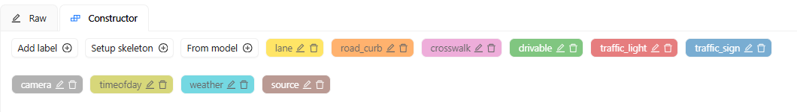
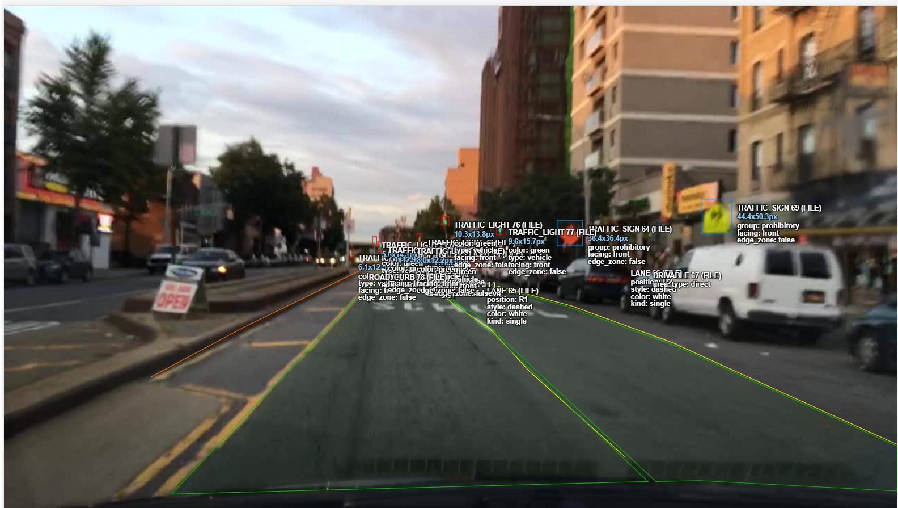
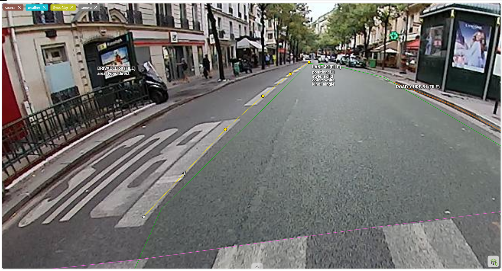
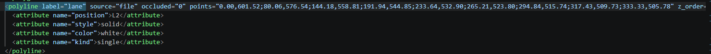

# Báo cáo cá nhân — Ngày 11
Họ tên: Phạm Thanh Tùng    Mã học viên: 03159  
Phiên bản CVAT (Help → About): 2.74.1  
Guideline: Road v1.0    Lần nộp (`revision` trong manifest): 1  
Thời điểm export (ngày giờ trên CVAT): 20/11/2026 22:25    Số lần nộp lại sau Rework: 0  

## 1. Kiểm project
| Mục | Đúng như guideline Road v1.0? | Ghi chú |
| --- | --- | --- |
| 6 label, đúng kiểu | Đúng | lane, road_curb: polyline; crosswalk, drivable: polygon; traffic_light, traffic_sign: rectangle. Project tạo lại từ `road_v1_labels.json` (dán ở tab Raw) |
| Thuộc tính và giá trị | Đúng | Đúng như file JSON của guideline |
| 4 tag ảnh | Đúng | camera, timeofday, weather, source; mỗi tag có thuộc tính select `value` |
Cách kết thúc polyline trên bản CVAT này: bấm phím N  
Cách đặt tag ảnh trên bản CVAT này: dùng công cụ Tag ở thanh bên trái, chọn label rồi bấm dấu +; sau đó mở Details của tag trong bảng Objects để chọn `value`  

## 2. Số lượng đã gán
| Task | Ảnh | lane | road_curb | crosswalk | drivable | traffic_light | traffic_sign |
| --- | ---: | ---: | ---: | ---: | ---: | ---: | ---: |
| front | 12 | 29 | 4 | 5 | 27 | 27 | 6 |
| front-extra (đã làm 4 / 4) | 4 | 10 | 2 | 7 | 9 | 9 | 6 |
| fisheye | 8 | 6 | 1 | 8 | 10 | 3 | 5 |
| fisheye-extra (đã làm 4 / 4) | 4 | 0 | 2 | 4 | 4 | 0 | 0 |

## 3. Bảng ca khó
| Ảnh | Nhãn | Phân vân giữa | Đã chọn | Lý do |
| --- | --- | --- | --- | --- |
| A07 | weather | clear / overcast / rain | rain | Mặt đường ướt rõ, kính xe có giọt nước (guideline: đường ướt rõ do mưa là rain) |

## 4. Phiếu QC 1 nhận được
Bạn kiểm lô của tôi: <ĐIỀN: tên bạn>  Quyết định nhận được: <ĐIỀN: Release / Hold / Rework>  
| Mã lỗi | Số lỗi | Đồng ý? | Đã sửa? |
| --- | ---: | --- | --- |
| <ĐIỀN sau khi nhận phiếu> | | | |

## 5. Kiểm file export
| File | Mở lại được? | Số shape ảnh 1 (job / file) | Số shape ảnh 2 (job / file) | Tag camera có trong XML? |
| --- | --- | --- | --- | --- |
| phamthanhtung-front.zip | Có (road_check lint mở được) | A01: 9 / 9 | A02: 6 / 6 | Có |
| phamthanhtung-fisheye.zip | Có (road_check lint mở được) | B01: 2 / 2 | B02: 4 / 4 | Có |

## 6. Ảnh chụp màn hình
1. Tab Labels của project.
2. Một ảnh camera trước đã gán đủ (làn, vùng lái, đèn/biển).
3. Một ảnh fisheye đã gán, phóng to đoạn polyline cong.
4. Một đoạn XML có <polyline label="lane">.

 

## 7. Tự đánh giá
Lỗi tôi mắc nhiều nhất hôm nay (theo mã QC1-xx), và cách tránh ở Ngày 20: QC1-02 (thiếu L1/R1) ở nhiều ảnh front, lint báo 7 chỗ, và QC1-05 (lint nghi vạch đứt bị tách thành nhiều polyline cùng position) ở A04, A09, A11, B03. Ở Ngày 20, trước khi Save mỗi ảnh tôi sẽ nhìn lại hai bên làn đang đi để chắc đã có L1 và R1 (nếu thật sự không thấy vạch thì xin coach xác nhận chứ không vẽ bừa), vẽ mỗi vạch đứt thành một polyline duy nhất, và chạy `lint` sau mỗi vài ảnh thay vì để đến cuối buổi.  
Nhãn của tôi đi vào model ở đâu? Chọn một lỗi đã sửa và nói nó làm model học sai thế nào: Nhãn của tôi đi vào tập huấn luyện của model nhận diện làn, vùng lái, đèn và biển. Một lỗi tôi đã sửa là ảnh B08 (camera phải) bị tôi gán tag `camera = front`. Nếu giữ nguyên, ảnh fisheye này sẽ nằm trong nhóm dữ liệu camera trước, và model sẽ học hình học của ảnh front từ một ảnh bị méo cong, nên dễ đoán sai vị trí làn và vùng lái.  

